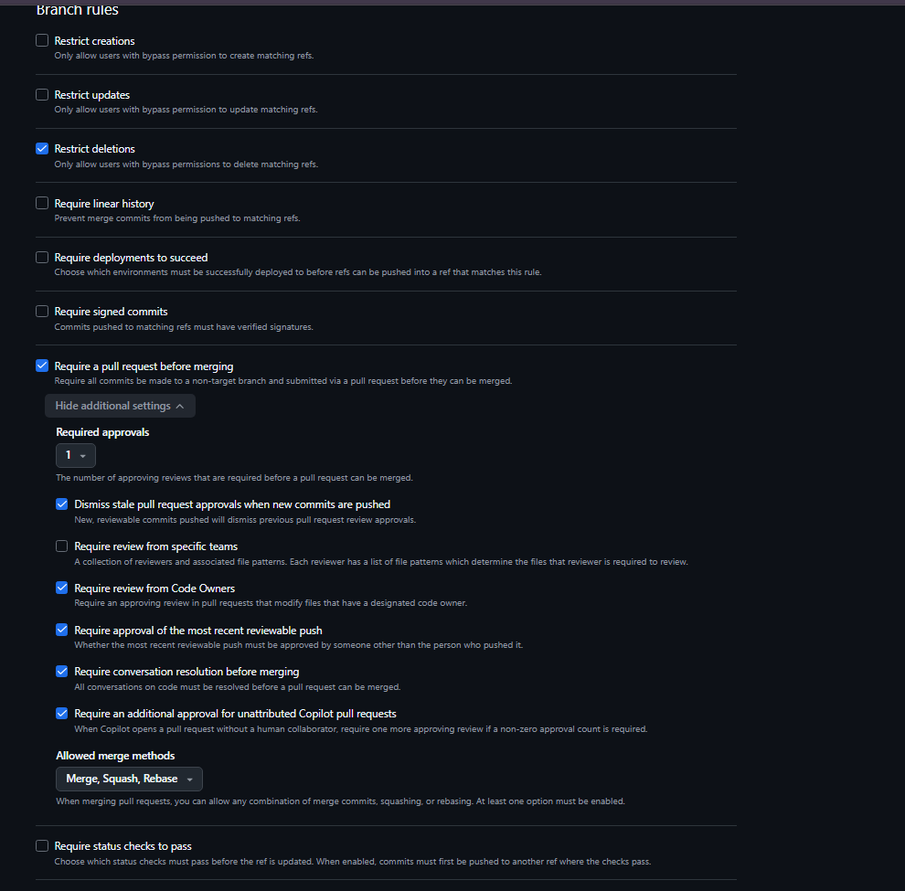

# Git Cheat Sheet: Frontend Branch Setup and Safe Pull

## 1. Create the repo and push the `frontend` branch

Run from `C:\AISupportTicketSystemTriage\frontend-support-ticket-triage`:

```
git init
git branch -M frontend
git add .
git status
git commit -m "Initial commit: frontend support ticket triage"
git remote add origin <same-url-as-backend-repo>
git push -u origin frontend
```

| Command | What it does |
|---|---|
| `git init` | Creates the local repo |
| `git branch -M frontend` | Renames the current branch to `frontend` |
| `git add .` | Stages all files (respecting `.gitignore`) |
| `git status` | Confirms `node_modules` and `.idea` are not listed |
| `git commit -m "..."` | Saves the first snapshot |
| `git remote add origin <url>` | Links the local repo to the remote |
| `git push -u origin frontend` | Creates the `frontend` branch on the remote and links it |

## 2. Create the working branch

```
git switch -c frontend-dev
git push -u origin frontend-dev
```

Do daily work on `frontend-dev`. Open a Pull Request into `frontend` (not `master`) when ready.

## 3. Daily workflow

```
git switch frontend-dev
git add .
git commit -m "Describe your change"
git push
```

## 4. Safe pull from remote

```
git status
git fetch origin
git log --oneline HEAD..origin/frontend
git diff HEAD origin/frontend
git merge origin/frontend
```

| Command | What it does |
|---|---|
| `git status` | Confirms your working tree is clean first |
| `git fetch origin` | Downloads remote changes without touching your files or branch |
| `git log --oneline HEAD..origin/frontend` | Lists the commits you're about to receive |
| `git diff HEAD origin/frontend` | Shows what would change |
| `git merge origin/frontend` | Applies the changes only when you're happy with them |
git log -3 --oneline origin/frontend   --> It gives the last 3 commits that had recently happened on the Remote repo
git status -sb       ---> Shows local repo and remote repo and [2] ->a number whihic tells how many commits loacl is behin of remote repo 
        O/P:-> ## frontend...origin/frontend [behind 2] 


Replace `frontend` with your current branch name if you're pulling on a different branch (for example `origin/frontend-dev`).

## 5. Handy extras

```
git branch                  # show current branch (marked with *)
git pull --ff-only          # safe one-line pull, refuses if histories diverged
git merge --abort           # undo a merge in progress
git stash / git stash pop   # set aside uncommitted work, then restore it
```


6. How to secure you  GIT REPO by Creating Guardrails/Rule Sets for commits done by Chatgpt to your remote repo
    I have connected my git repo ConnectMyCode<--->Ai-Ticket-Triage. SO when I Approve any commit from the Chatgpt widow the Commit should not be made instead a Pull Request is created and it needs my Approval .

   Your screenshot shows that you've enabled the most important setting, Require a pull request before merging, but a few settings need attention.
    Change the settings shown in your screenshot

        Why these matter:
        - 1 required approval: a reviewer must approve the PR.
        - 2 Dismiss stale approvals: if someone changes the code after approval, the old approval is invalidated.
        - 3 Approval of the most recent push: the person who pushes new changes cannot rely on an earlier approval; another person must approve the latest changes.
        - 4 Conversation resolution: review comments must be resolved before merging.


